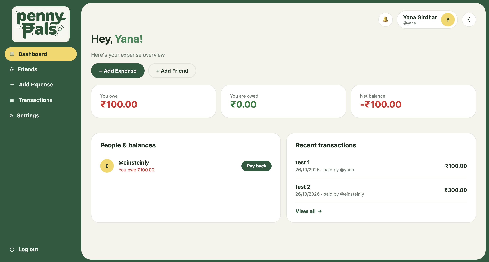
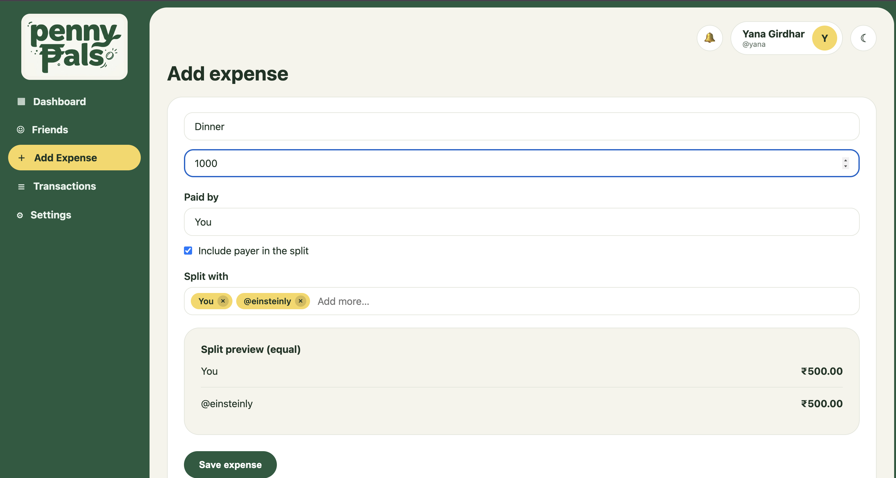
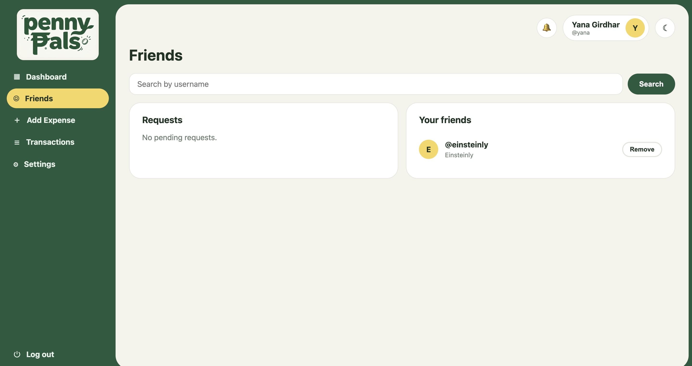
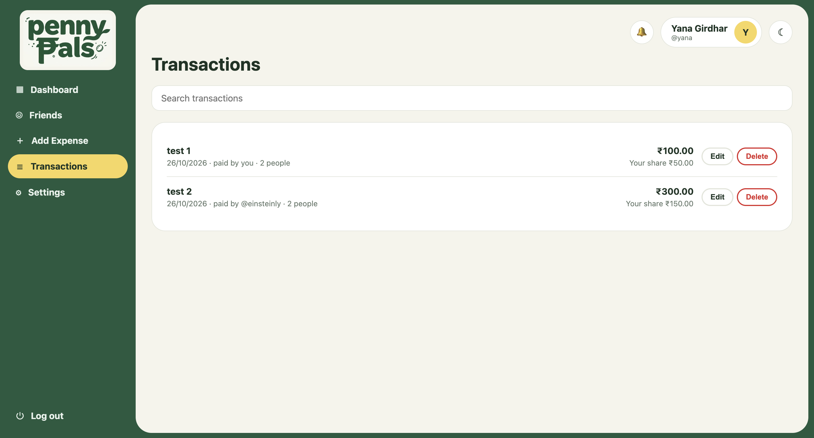
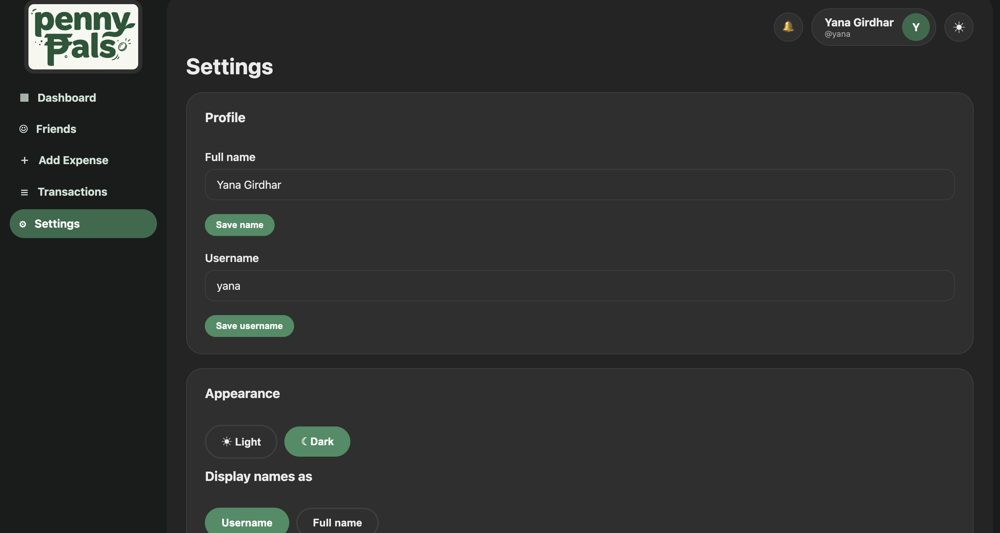

  

<h1 align="center">Penny Pals</h1>

  Split expenses with friends, track who owes whom, and settle up.

  <a href="https://YOUR-APP.vercel.app"><b>Live demo</b></a>

---

## Screenshots

| Dashboard | Add expense |
| :---: | :---: |
|  |  |

| Friends | Transactions |
| :---: | :---: |
|  |  |

| Dark mode |
| :---: |
|  |

## Features

- Sign up and log in with email and password (with email verification and password reset)
- Add friends by username and accept friend requests
- Create, edit and delete shared expenses with exact splits
- Dashboard with running balances per friend
- Record settlements between friends
- Notifications, a transaction history and profile settings
- Light and dark theme

> Settlements are *recorded only*. No real money moves through the app. All amounts are stored in paise to avoid rounding errors.

## Tech stack

- [React 18](https://react.dev) + [Vite](https://vitejs.dev)
- [React Router](https://reactrouter.com)
- [Supabase](https://supabase.com) (Auth, Postgres, Row Level Security)
- [Vercel](https://vercel.com) for hosting

## License

Released under the [MIT License](LICENSE).
